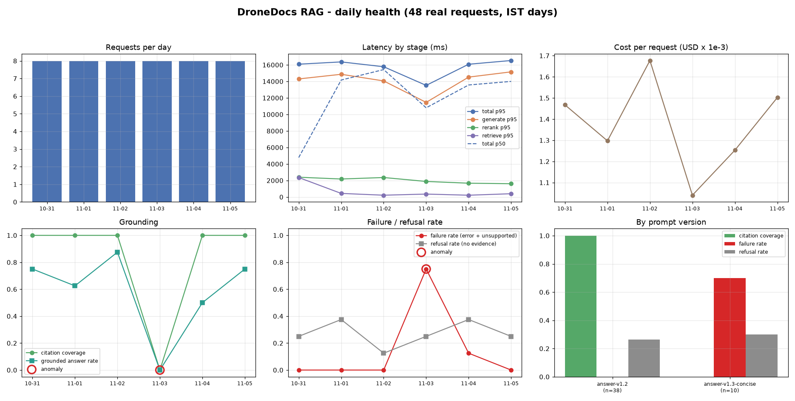
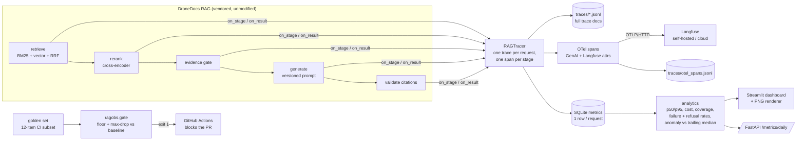
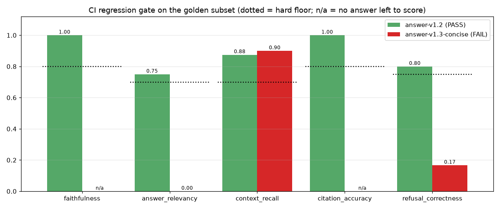

# RAG Observability: tracing, quality SLOs and a CI regression gate for a production RAG

<!-- links -->
[](https://github.com/burlarakesh1458-sys/rag-observability-gating/actions/workflows/regression-gate.yml) **Live demo:** <http://rakeshburla.dpdns.org/rag-observability-gating/> · **Code:** <https://github.com/burlarakesh1458-sys/rag-observability-gating> · **Resume bullets:** [RESUME_BULLETS.md](RESUME_BULLETS.md) · **License:** MIT

This repo adds an observability layer to the DroneDocs RAG system from [`dronedocs-production-rag`](https://github.com/burlarakesh1458-sys/dronedocs-production-rag):
cited Q&A over Indian drone regulations and ArduPilot/PX4 docs. It is built to answer one question:

> *"Quality degraded last Tuesday. What happened?"*

It answers by pulling up the dashboard, pointing at the anomaly and walking through the root cause
(see the [incident write-up](docs/incident-2026-11-03.md)). The same golden set then gates every PR,
so that change can't ship again.



## The problem

A RAG system rarely fails by crashing. It fails quietly: a prompt edit drops the citation rule,
a retriever change surfaces worse chunks, or a model swap doubles cost. Latency and HTTP-error monitors
stay green through all of it. You need to see **inside** each request (which chunks, what rerank order,
what prompt, what answer, how many tokens) and to track **quality** signals over time, not just
uptime.

## Architecture



The RAG package exposes observer hooks, so the tracing layer has no tracing-vendor dependency
and the RAG code is vendored untouched (`vendor/dronedocs-rag`, re-synced with `scripts/sync_vendor.sh`).

## Features

**Phase 1: tracing every step.** For each request, the trace records:

| Span | Captured |
|---|---|
| `retrieve` | vector hits, BM25 hits and the RRF-fused list (ids, scores, sources) |
| `rerank` | cross-encoder order with each chunk's pre-rerank position |
| `evidence_gate` | pass/fail, best score, threshold |
| `generate` | model, **prompt version**, the exact final prompt messages, raw response, prompt/completion tokens, retries, cost |
| `validate_citations` | cited / valid / invalid chunk ids, sentences vs cited sentences, coverage |

Traces are written three ways: as JSONL documents (always on, no infrastructure), as OpenTelemetry spans
following the GenAI semantic conventions plus Langfuse attributes (`langfuse.observation.type=generation`,
input/output, usage), and over OTLP/HTTP to Langfuse when `LANGFUSE_PUBLIC_KEY`/`LANGFUSE_SECRET_KEY` are set
(or to any collector via `OTEL_EXPORTER_OTLP_ENDPOINT`). `docker-compose.langfuse.yml` runs
self-hosted Langfuse v3. A real trace: [`traces/sample_trace.json`](traces/sample_trace.json).

**Phase 2: quality metrics over time** (`src/ragobs/analytics.py`), per day or per hour:

- latency p50 **and** p95 per stage (retrieve / rerank / generate / total). Averages hide the tail.
- cost per request in USD from token usage x a pricing table (`configs/observability.yaml`)
- citation coverage (share of answer sentences with a valid citation) and grounded-answer rate
- failure rate = errors + answers the citation validator rejected; refusal rate (declined for lack of evidence) tracked separately
- anomaly flags: each metric vs. the median of the previous 3 days, with per-metric rules
- a split by prompt version, which is what finds root causes

**Phase 3: regression gating** (`src/ragobs/gate.py`, `.github/workflows/regression-gate.yml`):
every PR runs a stratified 12-question golden subset through the *instrumented* pipeline with the
prompt/config in that commit. The build fails if a key metric falls below its hard floor or drops more
than `max_drop` below `baselines/eval_baseline.json`. Prompts and configs are versioned next to the code,
so a prompt edit is gated exactly like a code change. The gate writes a Markdown table to the job summary.

## Quickstart

```bash
python -m venv .venv && source .venv/bin/activate
make install-dev
cp .env.example .env                 # LLM_API_KEY (Groq) ; optional Langfuse keys
make ingest                          # build the vendored RAG index
make replay                          # 48 real requests over a simulated 6-day timeline (incl. the incident)
make charts                          # docs/dashboard.png, docs/regression_gate.png, reports/daily_metrics.json
make dashboard                       # interactive Streamlit dashboard on :8501 (drill into any trace)
make gate                            # CI regression gate on the 12-item subset (exit 1 on regression)
make test                            # offline unit tests (fake index/reranker/LLM, local OTLP collector)

# optional: self-hosted Langfuse
make langfuse-up                     # UI on :3000; set LANGFUSE_PUBLIC_KEY/SECRET_KEY in .env, re-run make replay
```

## Configuration (`configs/observability.yaml`)

| Section | Contents |
|---|---|
| `rag` | vendored settings file, production prompt (`answer_v1.yaml` = `answer-v1.2`), generator `qwen/qwen3.8-27b`, gate judge `openai/gpt-oss-120b` (a different model family), deployment overrides (`rerank.top_n: 3`) |
| `tracing` | JSONL / OTel span file / OTLP export, Langfuse host, prompt capture, attribute size cap |
| `pricing` | USD per 1M tokens per model (Groq list prices: gpt-oss-20b $0.075/$0.30, gpt-oss-120b $0.15/$0.60, qwen3.8-27b $0.80/$4.00) |
| `anomaly` | 3-day trailing window; rules: failure_rate +0.15 abs, refusal_rate +0.20 abs, citation_coverage -0.15 abs, total p95 latency +75%, cost/request +50% |
| `regression_gate` | baseline file, per-metric `floor` + `max_drop`, the 12-item CI subset |

## Results (all measured in this repo)

### 48-request replay with a real incident

`ragobs.replay --backfill` sent 48 real questions (golden questions plus user-style paraphrases and
off-topic questions) through the full pipeline with real Groq calls. Only the timestamps are simulated,
spread over Sat 10-31 to Thu 11-05 IST (8/day). On **Tue 11-03 10:00** the replay deploys
`answer-v1.3-concise`, a "token diet" prompt, and rolls it back **Wed 11-04 11:00**.

| Prompt | Requests | Citation coverage | Grounded answers | Failure (unsupported) rate | Tokens / req | Cost / req |
|---|---|---|---|---|---|---|
| `answer-v1.2` | 38 | **1.00** | 74% | **0.00** | 1,668 | $0.00147 |
| `answer-v1.3-concise` | 10 | **0.00** | 0% | **0.70** | 1,158 | $0.00101 |

The anomaly detector flagged exactly one day and exactly the right two metrics:

```
2026-11-03 failure_rate       +0.75 abs vs baseline 0.00   ['answer-v1.3-concise']
2026-11-03 citation_coverage  -1.00 abs vs baseline 1.00   ['answer-v1.3-concise']
```

Error rate was 0.00 every day, so a classic error-rate alert would have stayed silent. Total replay cost
was **$0.066** for 74,967 tokens.
Root cause and timeline: [`docs/incident-2026-11-03.md`](docs/incident-2026-11-03.md).

### CI regression gate: baseline vs. the regressed prompt



| Metric (floor / max drop) | `answer-v1.2` (baseline) | `answer-v1.3-concise` |
|---|---|---|
| faithfulness (0.80 / 0.05) | 1.000 | n/a: no answer survived validation, FAIL |
| answer_relevancy (0.70 / 0.10) | 0.750 | 0.000, FAIL |
| citation_accuracy (0.80 / 0.10) | 1.000 | n/a, FAIL |
| refusal_correctness (0.75 / 0.10) | 0.800 | 0.167, FAIL |
| context_recall (0.70 / 0.10) | 0.875 | 0.900, pass (retrieval untouched) |
| **gate** | **PASS** (exit 0) | **FAIL** (exit 1) |

Reports: `reports/gate_answer-v1.2_ci.json`, `reports/gate_answer-v1.3-concise_ci.json`.

**Replay mode (what CI runs on every push).** A live gate on every push made the build depend on Groq's
free-tier quota, so `python -m ragobs.gate --replay` keeps ingestion, retrieval, rerank, the evidence gate,
citation validation and tracing real but serves the generator's answers from
`baselines/recorded_answers_ci.jsonl` (the 10 answers of the baseline run above; the other 2 subset items are
declined by the evidence gate before any LLM call) and skips the judge. Only the deterministic metrics
(context recall, citation accuracy, refusal correctness) are gated, against the same baseline and floors. The
live gate (with judge) still runs on pull requests from this repo and on manual dispatch when the
`GROQ_API_KEY` secret is set. The replay run writes `reports/gate_answer-v1.2_ci_replay.json` and posts its table to the job summary.

### Latency (replay, `answer-v1.2`)

| Stage | p50 | p95 |
|---|---|---|
| retrieve (hybrid, CPU) | 181 ms | 488 ms |
| rerank (cross-encoder, 2 CPUs) | 1,446 ms | 2,523 ms |
| generate (Groq, incl. 429 backoff) | 12,648 ms | 14,969 ms |
| total | 13,909 ms | 16,484 ms |

The total is dominated by Groq **free-tier rate limiting**: 36 of 40 generation calls waited on at least
one HTTP 429 backoff. The 4 calls with no retry took 0.29-1.6 s. This is exactly what per-stage p50/p95
plus the `retries` attribute on the `generate` span exposes: the bottleneck is the provider quota, not
retrieval or the model.

## Design decisions and trade-offs

- **Observer hooks instead of decorators in the RAG code.** The RAG package stays vendor-neutral. Swapping
  Langfuse for Phoenix/Tempo means changing an exporter, not the pipeline.
- **JSONL + SQLite first, Langfuse optional.** The dashboards, anomaly rules and gate work with zero
  infrastructure (and in CI). Langfuse is a drop-in OTLP destination for richer UI when it's available.
- **Quality metrics are first-class SLOs.** Citation coverage and unsupported-answer rate caught the
  incident; latency and error rate didn't move.
- **Failure ≠ refusal.** A correct "I can't find this in the docs" is a success for unanswerable questions,
  so refusals (no evidence) and failures (unsupported answer / error) are tracked separately.
- **Gate = floor and max-drop.** Floors stop absolute badness; max-drop catches a slide from a good baseline
  that is still above the floor. A metric that cannot be computed (n/a) fails.
- **Small stratified CI subset (12 items).** A PR run fits the free-tier token budget. `make gate-full` runs
  all 60.
- **Simulated clock, real everything else.** History is needed for anomaly baselines, so the replay shifts
  timestamps only. Latencies, tokens, costs, answers and refusals are all real measurements.
- **Judge from another model family** (gpt-oss judges Qwen) to avoid self-preference.

## What went wrong and how I fixed it

| Problem | Fix |
|---|---|
| Two prompt versions served in one replay process would load the embedding model and cross-encoder twice on a RAM-constrained box | `shared_components`: pipelines share one index + reranker |
| Groq daily token cap (200k/model/day) hit mid-run | Quota errors are reported as **not evaluated** instead of scored as failures; replay stops on quota and supports `--resume` (request ids are deterministic, so rows are overwritten, not duplicated) |
| Deployment needed fewer tokens/request than upstream | `rag.overrides` in `observability.yaml` (`rerank.top_n: 3`, ~1.9k prompt tokens) without forking the vendored settings |
| Gate chart drew "0.00" for metrics that were really n/a | n/a labelled explicitly; n/a fails the gate |
| Free-text declines were counted as unsupported answers once the sentinel was gone | Documented in the incident; it is why the refusal sentinel is part of the gated prompt contract |
| Upstream RAG bugs (gpt-oss `【】` citation brackets, PIB duplicating Drone Rules facts, OOM during eval) | Fixed upstream in [`dronedocs-production-rag`](https://github.com/burlarakesh1458-sys/dronedocs-production-rag) and re-vendored |

## Limitations

- **Langfuse was not run in this environment** (no Docker in the sandbox). The OTLP export path is
  tested against a local OTLP/HTTP collector in `tests/test_otlp_export.py`, which checks the endpoint path,
  the Basic-auth header and the span names. All traces here went to JSONL + SQLite.
- **The incident is staged.** The prompt regression and its timeline were deliberately replayed. Every
  metric is real, but the timestamps are simulated and the traffic is 48 requests, not production volume.
- **Baseline gate scored 10 of 12 items.** The judge's free-tier daily quota ran out on 2 answered items
  (`ap-07`, `px-06`). They are listed as `not_evaluated_ids` in the report, not counted as passes.
- Small samples: 8 requests/day means a single request moves a daily rate by 12.5 points. The anomaly rules
  use abs thresholds and a minimum request count for that reason.
- Latency numbers reflect the Groq free tier and a shared 2-CPU sandbox, not production hardware.
- **The push-time gate replays recorded answers.** It catches code, config and retrieval regressions without an
  API key, but not a prompt change: that needs the live gate (PRs / manual dispatch).

## Future work

- Run self-hosted Langfuse and add Langfuse-native scores (faithfulness per trace) from the offline judge.
- Online evaluation: sample 5% of production traffic for async LLM-judge faithfulness.
- Hourly anomaly detection with seasonality and alert routing (Slack/PagerDuty webhook).
- Per-chunk analytics: which documents are retrieved but never cited (stale or noisy content).
- Canary deploys for prompt versions, with automatic rollback on the citation-coverage SLO.

## Repo layout

```
configs/observability.yaml       tracing, pricing, anomaly rules, gate thresholds, deployment overrides
configs/prompts/                 answer_v1.yaml (answer-v1.2, prod) + answer_v1_3_concise.yaml (regression fixture)
src/ragobs/                      tracing, store (SQLite), analytics, cost, charts, gate, replay, instrument, api
dashboard/app.py                 Streamlit dashboard with trace drill-down
scripts/                         render_dashboard.py, sync_vendor.sh
baselines/eval_baseline.json     gate baseline (answer-v1.2)
reports/                         daily_metrics.json, gate reports, replay log
docs/                            dashboard.png, regression_gate.png, incident-2026-11-03.md
traces/sample_trace.json         one real trace
vendor/dronedocs-rag/            vendored RAG package + corpus + golden set
```

## License

MIT
