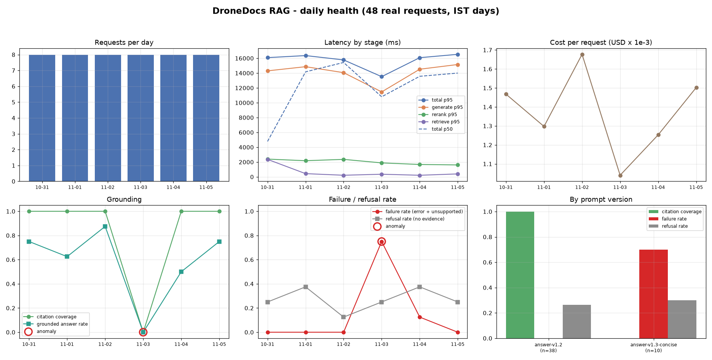
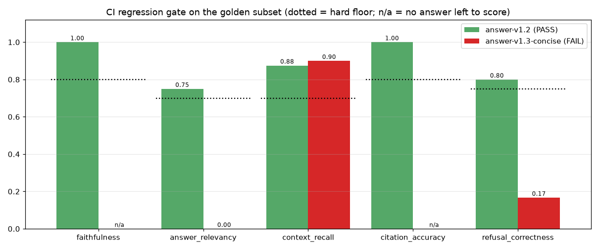

# Incident: grounded answers dropped to zero after the "token diet" prompt (Tue 2026-11-03)

| | |
|---|---|
| Status | Resolved (rolled back Wed 2026-11-04 11:00 IST) |
| Impact window | Tue 2026-11-03 10:00 IST to Wed 2026-11-04 11:00 IST (25 h) |
| User impact | 10 of 10 requests served by the new prompt returned no grounded answer: 7 were blocked as unsupported, 3 were declined by the evidence gate |
| Detection | Daily anomaly rules flagged `failure_rate` and `citation_coverage` for 2026-11-03 |
| Root cause | Prompt `answer-v1.3-concise` removed the citation and refusal-sentinel instructions |
| Prevention | The CI regression gate now runs on every prompt/config change and **fails** on this prompt |

> **How this incident was produced.** It is a staged incident, run end to end with real components.
> `ragobs.replay --backfill` sent 48 real questions through the instrumented pipeline: real hybrid
> retrieval, real cross-encoder reranking, and real `qwen/qwen3.8-27b` calls on Groq. Only each request's
> *timestamp* comes from a simulated clock, which spreads the traffic over 6 days (8 requests/day,
> 2026-10-31 to 2026-11-05 IST). The deployment timeline is in `src/ragobs/replay.py`
> (`DEPLOYMENTS`). Every number below was read from `data/metrics.sqlite` and `traces/*.jsonl`
> through `scripts/render_dashboard.py` (`reports/daily_metrics.json`).

## Timeline (IST)

| When | What |
|---|---|
| Sat 10-31 to Mon 11-02 | `answer-v1.2` in production. 24 requests, citation coverage 1.00, failure rate 0.00 every day. |
| **Tue 11-03 10:00** | PR "prompt: token diet for the answer prompt" ships `answer-v1.3-concise` (`configs/prompts/answer_v1_3_concise.yaml`). Intent: shorter answers for the mobile UI and fewer prompt tokens. |
| Tue 11-03 10:03 | First request on the new prompt (`rp-11031003-024`, "default BATT_LOW_VOLT"). The model answers "10.5 volts ... 10 seconds", which is correct but uncited, so the citation validator blocks it (`refused_no_citations`). |
| Tue 11-03 (day close) | Daily rollup: citation coverage **0.00** (baseline 1.00); failure rate **0.75** (baseline 0.00). Both anomaly rules fire: `failure_rate +0.75 abs vs baseline 0.00` and `citation_coverage -1.00 abs vs baseline 1.00`. |
| Wed 11-04 09:47 to 09:50 | Two more requests on the bad prompt: one blocked as uncited, one declined by the gate. |
| **Wed 11-04 11:00** | Rollback to `answer-v1.2`. The rest of the day is clean (the day's 0.125 failure rate is the 09:50 request). |
| Thu 11-05 | Fully recovered: citation coverage 1.00, failure rate 0.00. |

## What the dashboard showed

Daily rollups (8 requests/day; `failure_rate = error_rate + unsupported_rate`):

| Day (IST) | Prompt(s) | Citation coverage | Grounded answer rate | Failure rate | Refusal rate (no evidence) | Tokens / request | Cost / request |
|---|---|---|---|---|---|---|---|
| 10-31 | v1.2 | 1.00 | 0.75 | 0.00 | 0.25 | 1,666 | $0.00147 |
| 11-01 | v1.2 | 1.00 | 0.63 | 0.00 | 0.38 | 1,461 | $0.00130 |
| 11-02 | v1.2 | 1.00 | 0.88 | 0.00 | 0.13 | 1,908 | $0.00168 |
| **11-03** | **v1.3-concise** | **0.00** | **0.00** | **0.75** | 0.25 | 1,211 | $0.00104 |
| 11-04 | both (rollback 11:00) | 1.00 | 0.50 | 0.13 | 0.38 | 1,458 | $0.00125 |
| 11-05 | v1.2 | 1.00 | 0.75 | 0.00 | 0.25 | 1,667 | $0.00150 |

Split by prompt version (the "By prompt version" panel), which is what points at the cause:

| Prompt | Requests | Citation coverage | Grounded answer rate | Failure (unsupported) rate | Tokens / request |
|---|---|---|---|---|---|
| `answer-v1.2` | 38 | 1.00 | 0.74 | 0.00 | 1,668 |
| `answer-v1.3-concise` | 10 | 0.00 | 0.00 | 0.70 | 1,158 |

Latency and error rate did **not** move (error rate 0.00 on every day), so a latency/error-only
monitor would have stayed green. The PR's own success metric looked like a win: tokens per request
fell 31% (1,668 to 1,158 per request, by prompt version) and cost per request fell 31% ($0.00147 to $0.00101). Only the
**quality** signals (citation coverage, unsupported-answer rate) showed the outage.

## Root cause

The diff between `answer_v1.yaml` (`answer-v1.2`) and `answer_v1_3_concise.yaml`:

- removed *"After every sentence that states a fact, cite the supporting passage id(s) in square brackets"*
- removed *"If the passages do not contain the answer, reply with exactly: INSUFFICIENT_EVIDENCE"*
- added *"Be confident and helpful; avoid unnecessary caveats"*

With no instruction to cite, the model stopped emitting `[chunk_id]` markers. The pipeline's citation
enforcement (`validate_citations`) then did its job: it will not show an answer with zero valid
citations, so every LLM answer became `refused_no_citations`. Most of those answers were factually right
("10.5 volts for 10 seconds", "INR One lakh"), but the system could not prove it, so users got nothing.

Two secondary effects, visible in the traces:

- **Declines became "unsupported".** Without the sentinel, the model declined in free text ("The
  provided context does not list specific mandatory safety features…", request `rp-11031850-027`),
  so the dashboard counted a legitimate decline as an unsupported answer.
- **Unsupported claims do appear.** In the CI gate run of the same prompt, the model answered the
  PX4 auto-disarm question with "10 seconds". The golden answer is 2 seconds. The validator blocked it
  only because it had no citation, which shows the guardrail was the last line of defence.

## Why the guardrail held but the user experience failed

Citation enforcement turned a potential **hallucination incident** into an **availability incident**.
That is the right failure direction for a regulations assistant, but it still made the product useless
for 25 hours. The change also shipped without the offline eval, because at the time CI only ran unit tests.

## Fixes

1. **Regression gate in CI** (`.github/workflows/regression-gate.yml`, `python -m ragobs.gate`). Every
   PR that touches prompts, configs or code runs a stratified 12-question golden subset through the
   instrumented pipeline and compares it to `baselines/eval_baseline.json`. A metric fails if it drops
   below its floor or falls more than `max_drop` below the baseline.
   Replaying this incident's prompt through the gate (`reports/gate_answer-v1.3-concise_ci.json`):

   | Metric | Baseline `answer-v1.2` | `answer-v1.3-concise` | Result |
   |---|---|---|---|
   | faithfulness | 1.000 | n/a (no answer left to score) | FAIL |
   | answer_relevancy | 0.750 | 0.000 | FAIL (floor 0.70) |
   | citation_accuracy | 1.000 | n/a | FAIL |
   | refusal_correctness | 0.800 | 0.167 | FAIL (floor 0.75) |
   | context_recall | 0.875 | 0.900 | pass (retrieval unchanged) |

   The gate exits 1, so this PR would have been blocked. `context_recall` passing is expected and useful:
   it shows retrieval was fine and the regression sat entirely in generation.

   

2. **Prompt version on every trace and metric row** (already in place, and the reason the root cause took
   minutes to find): the per-version split pointed straight at `answer-v1.3-concise`.
3. **Anomaly rules on quality, not just latency/errors**: `citation_coverage` (abs drop > 0.15) and
   `failure_rate` (abs increase > 0.15) against the trailing 3-day median (`configs/observability.yaml`).
4. Follow-up: the "concise" goal is still valid. Re-do it as `answer-v1.4` that keeps the citation and
   sentinel rules, and ship it only after the gate passes.

## Caveats

- The baseline gate run scored 10 of 12 items. Two answered items (`ap-07`, `px-06`) could not be judged
  because the judge model's free-tier daily quota ran out. They are reported as *not evaluated*
  (`summary.not_evaluated_ids`), not as passes. The regressed run needed no judge calls, because nothing
  survived validation.
- Generation latency in this replay is dominated by Groq free-tier rate limiting (36 of 40 generation calls
  went through at least one HTTP 429 backoff; calls with no retry took 0.29-1.6 s), so latency numbers
  here measure the free tier, not the model.
